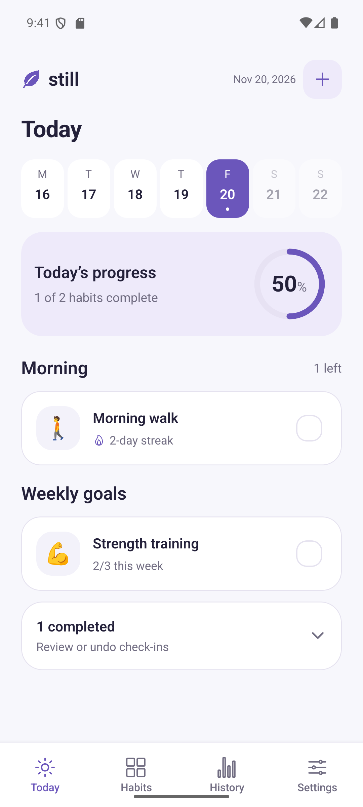
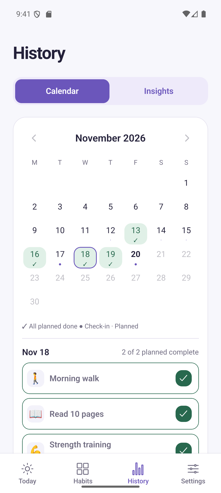
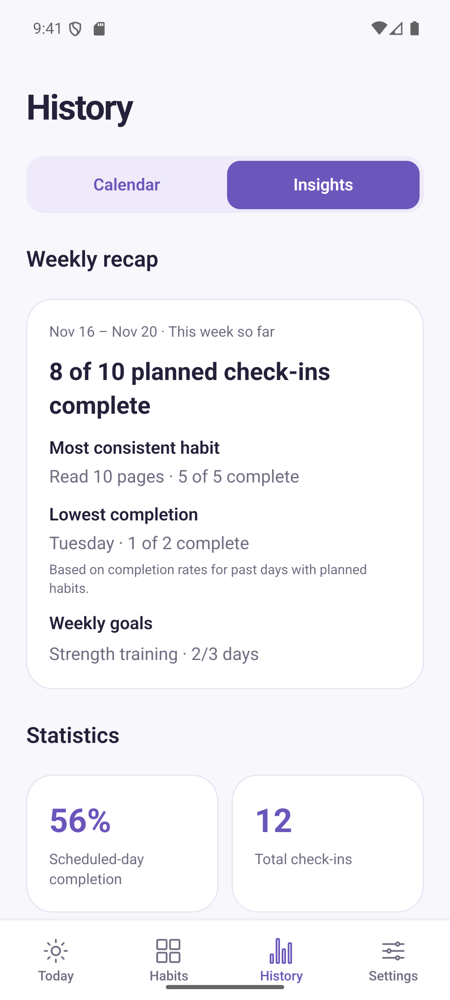

# Still

Still is an offline habit tracker built for everyday use on Android. I wanted to open my phone, see which habits needed attention, and check one off without signing in or needing a connection.

<p>
  
  
  
</p>

Android screenshots with sample habits.

## Design decisions

- **Keep the daily list easy to scan.** Today shows unfinished habits first and folds completed check-ins into a section you can reopen to undo one. A tap saves to SQLite and updates the screen as soon as the save succeeds. Reminder updates happen in the background.
- **Keep data on the phone.** SQLite stores habits, settings, and check-ins. Android release builds have no internet permission and opt out of automatic backup and device transfer. That keeps tracking independent of an account or server, and it means uninstalling the app can erase your history.
- **Let routines change without rewriting their history.** Schedule edits take effect from the date of the change. Earlier check-ins still use the schedule that was active then. Paused days are skipped in scheduled-day streaks, and flexible weekly goals let you choose which days count toward the target.
- **Make reminders resume on their own.** The first reminder after a pause used to be a one-off. If you missed it, the next reminder depended on reopening Still. The Android app now schedules a repeating reminder that starts on the first eligible day. On a Pixel 7 emulator, a second reminder arrived after both a pause and a completed weekly goal while the app stayed closed.

## How I built it

Still uses Expo, React Native, TypeScript, Expo Router, and SQLite, with a small Kotlin module for Android reminders. Calendar and streak rules live in TypeScript functions that can be tested independently of the UI.

I used **OpenAI Codex** to help implement features, write tests, and debug Android behavior. I directed the feature choices and used each round of feedback to decide what to simplify or improve.

## Try it

Use Node.js 24 and npm to run the browser preview.

```sh
npm ci
npm run web
```

With an Android emulator running, use `npm run android` for the native app. Android is the tested target for reminders and the home-screen widget.

- Look under **Releases** on GitHub for a standalone Android APK. Install updates over your current copy to keep local history.
- [Developer guide](./docs/running-still.md) covers native builds, checks, and project structure.
- [Verification record](./VERIFICATION.md) documents the automated tests and Android emulator checks.

[MIT license](./LICENSE)
